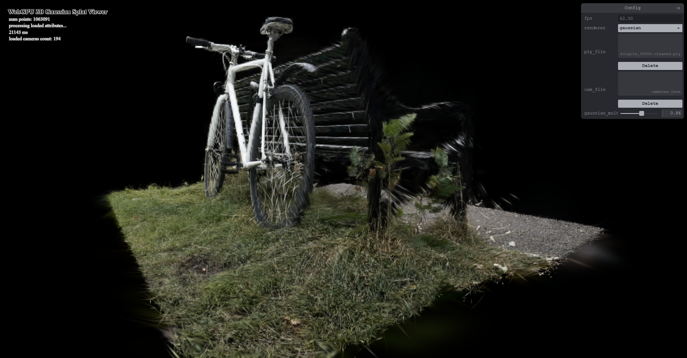
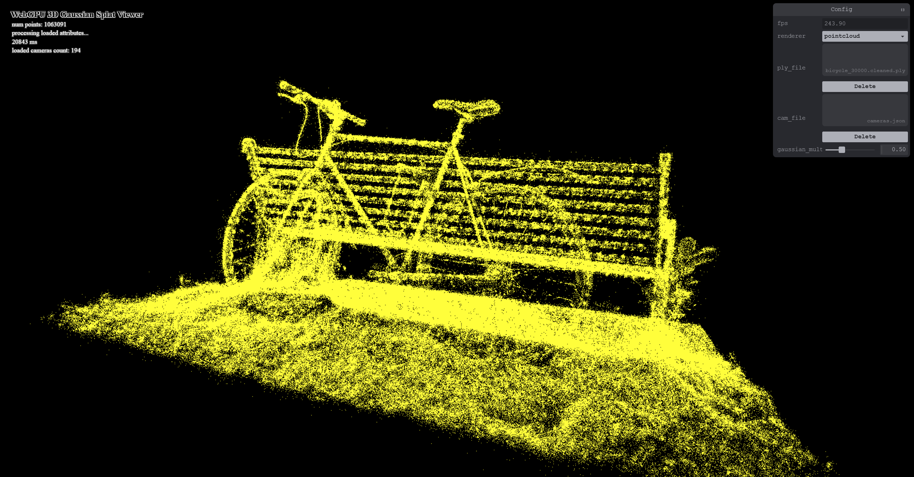

# Project5-WebGPU-Gaussian-Splat-Viewer

**University of Pennsylvania, CIS 565: GPU Programming and Architecture, Project 5**

* **Name:** Yingxuan Hu
* **LinkedIn:** [linkedin.com/in/yingxuan-hu-bbb9b3380](https://www.linkedin.com/in/yingxuan-hu-bbb9b3380/)
* **Tested on:** Windows 11, Intel(R) Core(TM) i9-14900HX @ 2.20 GHz, NVIDIA GeForce RTX 5070 Ti Laptop GPU (12 GB)
* **Computer:** Personal Computer
* **Browser:** Google Chrome 155.0.8059.80 (Official Build) (64-bit)

## Live Demo

[Live Demo](https://jagercg.github.io/Project5-WebGPU-Gaussian-Splat-Viewer/)

## Demo Video

[Watch the demo video](images/demo.mp4)

---

## Overview

This project implements a WebGPU Gaussian splat viewer with both point-cloud and Gaussian rendering modes.

## Implementation

### Point Cloud Rendering

The point-cloud renderer transforms the Gaussian positions using the camera view and projection matrices and renders them as yellow points.

### Gaussian Preprocessing

The Gaussian renderer uses a compute shader to preprocess the loaded Gaussian data before rendering.

View-frustum culling removes Gaussians outside the visible region. The remaining Gaussians are compacted into the splat buffer using an atomic counter, and the visible count is copied into the indirect draw buffer.

### Gaussian Covariance

The stored scale values are converted from log space, and the stored quaternion is converted into a rotation matrix. These values are used to construct the 3D covariance matrix.

The covariance is transformed into camera space and projected into a 2D screen-space covariance. The resulting covariance is used to calculate the conic matrix and screen-space radius of each splat.

### Depth Sorting

Visible splats are assigned depth keys and sorted using the provided GPU radix sorter. The sorted indices are used during rendering so that the splats are drawn from back to front.

### Spherical Harmonics Color

The spherical harmonics coefficients loaded from the PLY file are unpacked and evaluated using the viewing direction. The resulting RGB color is stored with each processed splat.

### Gaussian Rendering

Each Gaussian is rendered using a screen-space quad sized according to its projected radius.

The fragment shader evaluates the Gaussian falloff using the conic matrix and the pixel-space offset from the Gaussian center. The resulting opacity is combined with the stored Gaussian opacity and composited using alpha blending.

The Gaussian multiplier in the UI controls the scale of the rendered Gaussians.

---

## Performance Analysis

### Test Setup

All performance measurements were collected on the same machine and browser using a fixed camera position and window size. Unless otherwise stated, the bicycle scene was used with the Gaussian multiplier set to 0.5. 

### Point Cloud vs. Gaussian Renderer

| Renderer | Average FPS |
| --- | ---: |
| Point Cloud | 240 |
| Gaussian | 75 |

The point-cloud renderer reached about 240 FPS, while the Gaussian renderer reached about 75 FPS under the same test conditions. The point-cloud renderer is much faster because it mainly transforms and draws the input points. The Gaussian renderer performs additional preprocessing, depth sorting, quad rasterization, Gaussian evaluation, and alpha blending for the visible splats.

Compared with the point-cloud result, the Gaussian renderer produces continuous surfaces with the reconstructed scene colors instead of displaying the scene as separate yellow points. The point cloud clearly shows the overall geometry, but gaps between individual points remain visible. Gaussian splatting fills these regions using the projected size and opacity of each Gaussian, producing a much more complete reconstruction.

### Effect of Compute Workgroup Size

| Workgroup Size | Average FPS |
| ---: | ---: |
| 64 | 120 |
| 128 | 110 |
| 256 | 85 |

The preprocess workgroup size had a noticeable effect on performance. A workgroup size of 64 produced the highest measured performance at about 120 FPS, followed by 128 at 110 FPS and 256 at 85 FPS. For this workload and GPU, increasing the workgroup size did not improve performance. The smaller workgroup size provided better performance for the Gaussian preprocessing pass in this test.

### Effect of View-Frustum Culling

| View-Frustum Culling | Average FPS |
| --- | ---: |
| OFF | 30 |
| ON | 85 |

View-frustum culling had a large effect in this test. Disabling culling reduced performance to about 30 FPS, while enabling it increased performance to about 85 FPS. With culling enabled, Gaussians outside the enlarged view region are discarded during preprocessing and do not continue into the visible splat list, sorting, and rendering stages. This reduces the amount of work performed later in the frame when a significant portion of the scene is outside the camera view.

### Effect of Gaussian Count

| Number of Gaussians | Average FPS |
| ---: | ---: |
| 272956 | 230 |
| 1063091 | 85 |
| 6131954 | 30 |

The Gaussian count had a clear effect on rendering performance. The renderer achieved about 230 FPS with 272,956 Gaussians, 85 FPS with 1,063,091 Gaussians, and 30 FPS with 6,131,954 Gaussians.

As the Gaussian count increased, more work was required during preprocessing, sorting, and rendering. More splats also increased the amount of rasterization and alpha blending work. The performance decrease was not perfectly proportional to the Gaussian count because the final cost also depends on how many Gaussians are visible and how much screen space their projected splats cover.

---

## Conclusion

This project implements both point-cloud and Gaussian rendering in WebGPU. The Gaussian renderer preprocesses the loaded data on the GPU, performs view-frustum culling and depth sorting, projects the 3D Gaussian covariance into screen space, evaluates spherical harmonics color, and renders the final splats with alpha blending.

The performance tests show that Gaussian rendering is more expensive than point-cloud rendering, while view-frustum culling provides a clear performance benefit. The preprocess workgroup size also affects performance, and larger Gaussian counts reduce the final frame rate because more data must be processed, sorted, and rendered.

---

## Credits

- [Vite](https://vitejs.dev/)
- [tweakpane](https://tweakpane.github.io/docs//v3/monitor-bindings/)
- [stats.js](https://github.com/mrdoob/stats.js)
- [wgpu-matrix](https://github.com/greggman/wgpu-matrix)
- Special Thanks to: Shrek Shao (Google WebGPU team) & [Differential Gaussian Renderer](https://github.com/graphdeco-inria/diff-gaussian-rasterization)